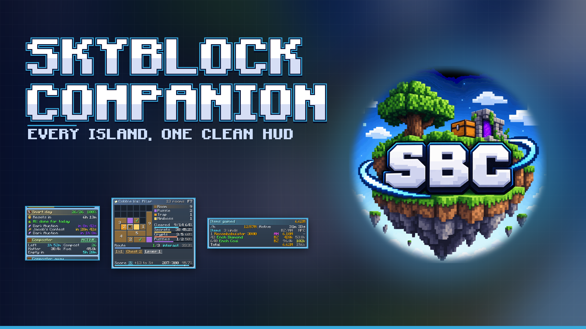
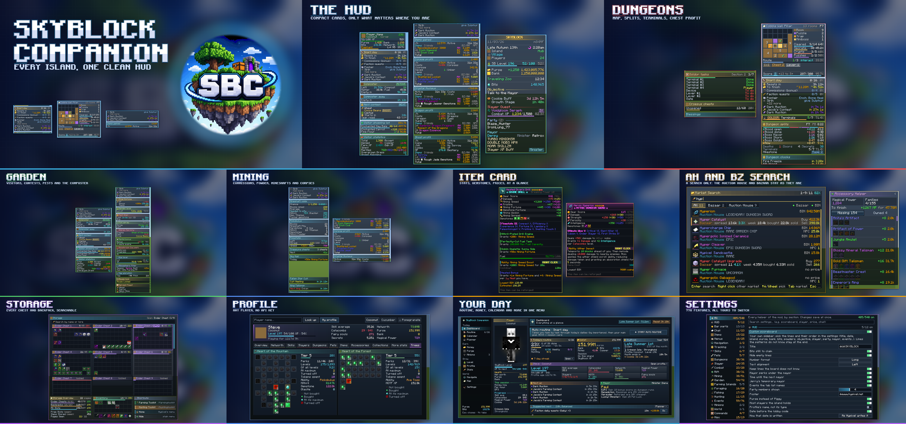

# 🌍 SkyBlock Companion

### One mod for all of Hypixel SkyBlock

Replaces the stack of mods you’d normally run: tooltips and prices, a picture warp menu, a minimap, trackers, garden, mining, crimson, rift, dungeon and slayer helpers, profile viewer and more. One mod, one look, one settings menu.

**450+ features · 30+ trackers · every island · one clean look**

---

> ### ⌨️ Press **K** in game. That's the whole manual.
> The first time you start the game, a short setup asks what you play and how it should look, then shows you the keys one by one. Every feature can be switched off, and every card can be moved in the HUD editor (**H**).

> **It shows you the information and leaves the playing to you.** Nothing clicks, moves or sends anything for you.

---

## ✨ At a glance

| | | |
|:---:|:---:|:---:|
| 📊 **HUD**   Compact cards that only show what matters on the island you're on | 💰 **Trackers**   Coins per hour for everything you grind, from your own drops | 🧰 **Helpers**   Panels beside Hypixel's menus, never in place of them |
| 🗺️ **Travel**   Picture warp menu, minimap, path line, waypoints | 🏷️ **Items**   Prices, values and clean item cards on every tooltip | 👤 **Profiles**   `/pv` any player, no API key needed |

---

## 💰 Trackers

### Every tracker counts what you actually get, values it at live Bazaar and Auction House prices, and shows **coins per hour** and the session total. Pause, reset, or switch between session, day, week and all time.

| Activity | Trackers |
|---|---|
| 🌾 **Farming** | Farming profit · Pest profit · Pesthunter profit · Trevor tracker |
| ⛏️ **Mining** | Mining profit · Powder tracker · Excavator profit · Corpse profit · Crystal Nucleus profit · Mining event tracker · Dark Monolith tracker |
| ⚔️ **Slayer & Combat** | Slayer profit · Dragon profit · Ghost profit · Ender Node profit · Sacrifice profit · Carry tracker |
| 🏰 **Dungeons** | Dungeon chest tracker · Reward chest profit · Secrets per player |
| 🎣 **Fishing** | Fishing profit · Sea creature session · Shark counter · Trophy fish |
| 🌲 **Foraging & Hunting** | Foraging tracker · Hunting profit · Shard tracker |
| 🌀 **Rift** | Timite tracker · Vermin tracker |
| 🎉 **Events** | Diana profit · Jerry's Workshop profit · Gift profit · Shiny Orb profit · Fishy Treat profit · Beach Ball tracker · New Year Cake tracker |
| 🧪 **More** | Experiments profit · Inferno Minion profit · Items gained · Overall profit |

---

## 🏝️ Islands and activities

<b>🌾 Garden & Farming</b> (80+ features)

- **Farming card**: crops per minute, coins per hour, optimal speed for your tool, yaw and pitch, true fortune
- **Pests**: infested plots in the world, pest finder, pest timer, spawn title and sound, pest guess, plot spray, pest trap warnings
- **Visitors**: offer prices, what you're missing (shopping list), statistics, charmed visitors, status in the world, offer guard
- **Composter**: card, warnings, helper, works outside the Garden too
- **Jacob's Contest**: next contest, contest helper, summary, personal best fortune, contest menu
- **Garden Plots panel** beside your inventory: click a plot to teleport
- Crop milestones, best crop to farm, Garden and hoe level, Greenhouse: DNA Analyzer, Phantomleaf, crop diagnostics
- SkyMart copper prices, Anita medal prices, plot price and borders
- Farming lanes, mouse lock, farming keys, see-through window, prevent breaking crops, wrong speed warning
- **Farming Islands**: Trevor helper and card, animal finder, Treasure Hunter, Hungry Hiker, glowing mushrooms

<b>⛏️ Mining</b> (50+ features)

- **Commissions** card with places, commission mobs and finished commissions in the menu
- **Powder** this session and per hour, Actual Gemstone Powder, Crystal Hollows powder tracker
- **Glacite Mineshaft**: corpses, cave-in timer, pity counter, odds, ordered waypoints
- **Crystal Hollows**: map, places, area walls, nucleus crystal boxes, treasure chests, Metal Detector
- Fossil Excavator solver, treasure distance and fossil progress
- Heart of the Mountain, Sky Mall, Pickobulus, Flowstate, King Talisman
- Mining events, Fallen Star Cult, Dark Monolith marks, Golden Goblin, freezing warning, cold frost
- Ores by commission, Precision Mining spot, drill fuel bar, quieter mines, Deep Caverns guide

<b>🏰 Dungeons</b> (60+ features)

- **Room detection** with secret waypoints and **secret routes** (etherwarp, mine, TNT and interact spots)
- **Room map**, live score with chimes at 270 and 300, splits, deaths, run clock, next door
- **Puzzle solvers**: Blaze, Boulder, Creeper Beams, Ice Fill, Ice Path, Quiz, Teleport Maze, Three Weirdos, Tic Tac Toe, Water Board
- **Floor 7**: terminals (Simon Says, Lights On, Arrow Align, Target Practice and terminal windows), Goldor tasks, Livid finder
- **Party Finder** as cards with faces, classes, search and filters, and **who joined your party** (levels, Magical Power, gear)
- Spirit Leap class colours, low health and teammate warnings, starred mobs, keys on the ground, blessings
- Croesus and reward chest profit, salvage helper, sellable items, blood camp helper, clean end

<b>⚔️ Slayer & Combat</b> (75+ features)

- **Slayer helper**: boss box, kill times against your best, bosses to the next level, RNG Meter, remaining kills
- Boss spawn warning, slayer quest warning, minibosses, items on the ground, unclaimed rewards
- **Inferno Demonlord**: attunement alerts, Hellion shield colours, daggers, fire pits and pillars
- **Voidgloom**: beacons, Yang Glyphs, Nukekubi skulls · **Tarantula**: egg sacs, cocoons · **Riftstalker**: Bloodfiend helper
- Damage indicator, mob health bars, compact damage, boss health, area bosses
- Dragon fight and dragon weight, Zealot kills, End Stone Protector, Ender Node boxes, Arachne, Broodmother
- Deployables, flares, quiver display and low quiver warning, Bestiary helper, combat session

<b>🔥 Crimson Isle & Kuudra</b>

- **Daily quests**, minibosses and Kuudra tiers on one card, quest markers, **reputation helper**
- Miniboss respawn timers per area, Vanquisher sharing with waypoint and beam
- **Kuudra**: tier detection, supply, fuel, ballista, safe and pearl spots
- Dojo tests and rank, Ashfang, Magma Boss phase, volcano explosivity, Sulphur Skitter box, Rescue Mission waypoints

<b>🎣 Fishing</b> (30+ features)

- **Sea creature tracker** with rare catch alerts, sea creature cap, health and kill time
- **Bobber timer** with a bite mark, reel timer, Hotspot radar, bait display
- **Trophy fish** collection and chat, Golden Fish, Totem of Corruption, shark counter
- Thunder Spark, Geyser, Wormhole finder, coral fish helper, lava replacement, lootshare range

<b>🌲 Foraging & Hunting</b>

- **Tree progress**, sweep details and overlay, tree felled title, clean tree view
- Honeyhive and phantom alerts, Heart of the Forest, Starlyn contests and coupon prices, temple puzzles
- **Hunting**: shard tracker, Safari helpers and shard checklist, Pure Reptile alert, Hideyho finder, shulker finder, lasso, empty trap guard

<b>🌀 The Rift</b> (30+ features)

- **One Rift panel** for motes orbs, effigies, enigma souls, vermin, buttons and punchcards
- Rift timer, Crux Talisman progress, Ubik's Cube reminder, kill-zone warning
- Blood Effigy, Motes Orb and Enigma Soul waypoints, parkour helpers
- Bacte fight, Dance Room, Crafting Room, Living Cave, Wyld Woods, Sun Gecko, Kloon hacking

<b>🎉 Events</b> (75+ features)

- **Diana**: burrow guessing, nearest warp, rare mob sharing, Griffin pet warning
- **Hoppity**: egg waypoints, respawn timers, stray rabbits, missing rabbits, hunt summary and stats
- **Chocolate Factory**: best upgrade highlighted, goals, shop prices, Time Tower and barn warnings
- **Great Spook**, winter gifting, Jerry's Workshop, **Carnival** games, Beach Ball, Bingo card, Century Party
- Event board with Dark Auction, Jacob, Spooky Festival, Traveling Zoo, Harvest Feast and more; calendar reminders, Stonks Auction, City Project

---

## 🧰 Helpers beside Hypixel's menus

### Panels that open **next to** the chest you're in. Hypixel's menus stay exactly as they are.

| Helper | What it does |
|---|---|
| 💍 **Accessory helper** | Missing accessories, Magical Power to gain and what it costs |
| 🐾 **Pet helper** | Pet details, progress to max level, pet items, Taming 60 |
| 🏛️ **Museum helper** | What you still need, complete categories |
| 🔨 **Reforge & anvil** | Reforge stats compared, anvil combinations |
| 📦 **Sacks & storage** | Sack display and value, all your storage on one screen |
| 👔 **Custom wardrobe** | Your armor sets, with number keys |
| 🧪 **Essence Shop, Bits, Super craft** | What it costs, what you can afford, what a craft is missing |
| 🔍 **AH and BZ Search** | Search the Auction House and Bazaar as you type, with prices (a search only; the AH and BZ stay as they are) |
| 🗂️ **Item list** | Every item with its recipe, beside any inventory |

#### ➕ Plus: Ctrl+F in any chest, quick navigation buttons, page turning with the mouse wheel, sign calculator, chest value, trade value, attribute shards, RNG Meter and Stats Tuning menus, calendar extras.

---

## 🏷️ Items and tooltips

#### 💵 **Prices on every tooltip**: Bazaar, lowest BIN, NPC price, craft cost and estimated value, with a value breakdown
#### ✅ A lowest BIN that says when nothing is listed, instead of showing an old price
#### 🃏 **Clean item cards**: lined-up stats, gemstone tiles, fuel bars, coloured enchantments, stat icons
#### 🔒 **Slot locking and item protection**, consumable protection
#### 🔢 Numbers on items: stars, levels, tiers, attributes, Magical Power, ability cooldowns
#### 🎒 Backpack and compactor contents on the tooltip, scrollable long tooltips, wiki and price lookup keys
#### 🎨 Custom item looks and armor dye, visible only to you

---

## 📊 HUD

#### **Status bars** for health, mana and defense, with effective HP, and **skill progress**
#### **Custom scoreboard** and **custom tab list** (with an FPS box), and `/tab` widgets on the HUD
#### **Player card** with level, networth, purse and bank, plus equipped pet, mayor and perks, SkyBlock date and time
#### **Routine list**: your daily tasks, ticked off by themselves as you do them
#### **HUD editor (H)**: move, resize and restyle every card, grouped by activity

---

## 💬 Chat

#### **Compact messages** for bestiary, potions, rewards, experiments and more
#### **80 filters** for spam and repeated lines, every one switchable
#### **Your own chat rules** to hide, replace, colour or alert on any line
#### NPC dialogue as an on-screen box with numbered answers
#### Party tab-complete, short party commands, reparty, peek chat, copy chat lines, shorter coin amounts

---

## 🗺️ Travel

#### 🖼️ **Picture warp menu**: every island as a picture, click a portal
#### 🧭 **Minimap**, island map (**N**), path line to where you're going and an arrival title
#### 📍 **Waypoints** you can share and import, fairy soul pathfinder, relic route, event baskets

---

## 👤 Profiles and planning

#### `/pv` **any player**: skills, slayers, dungeons, pets, items, accessories, collections, networth, Heart of the Mountain and Forest
#### **Daily routine** with a guide line to the next task, and a planner for what to do next
#### **Money methods** rated by your own gear and levels, Forge and minion panels
#### Reminders, todos, shortcuts and speed presets
#### **The SkyBlock Wiki inside the game** (F1 over an item)

---

## 📥 Install

| | |
|---|---|
| **Minecraft** | The version shown on the [latest release](https://github.com/Skyblock-Companion/SBC/releases/latest) |
| **Loader** | [Fabric Loader](https://fabricmc.net/use/installer/) |
| **Fabric API** | Already included |
| **Side** | Client only |

### Drop it into your `mods` folder and start the game. The setup takes it from there.

---

## 🌐 External requests

### SkyBlock Companion makes a few requests so its features work:

- **Profile viewer & museum**: sends the player or profile UUID you look up to the project's own server, which reads it from the Hypixel API and caches the answer. That's why you don't need an API key.
- **Update check**: when the game starts, sends only the mod's version to the project's own server, which answers whether a newer version is out.
- **Prices**: Bazaar and auction data from the public [Hypixel API](https://api.hypixel.net), a lowest BIN list from the project's [data repository](https://github.com/Skyblock-Companion/sbc-data), and item prices from [SkyHelper Prices](https://github.com/SkyHelperBot/Prices). Nothing about you is sent.
- **Game data & pictures**: island pictures, maps and game data from the project's [data repository](https://github.com/Skyblock-Companion/sbc-data), which holds copies of SkyHanni-REPO, NotEnoughUpdates-REPO and others with their credits and licences. Nothing about you is sent.
- **Wiki**: reads pages from the [Hypixel SkyBlock Wiki](https://hypixelskyblock.minecraft.wiki) when you open them in the in-game wiki.
- **Links**: the Discord, GitHub and Modrinth buttons open your browser only when you click them.

No API key is needed, and no private data is ever sent to a third party.

---

## ❤️ Credits

Made by **zMuzy**, with AI assistance.

Huge thanks to **SkyHanni**, **Skyblocker**, **NotEnoughUpdates**, **SkyHelper** and everyone in the mod's credits screen. Some of the mod's logic, data and menus come from their work.

Licensed under **GPL-3.0**. Images and map data keep their own CC BY-NC-SA licences.

Not an official Minecraft product. Not approved by or associated with Mojang or Microsoft. Not affiliated with Hypixel Inc.

